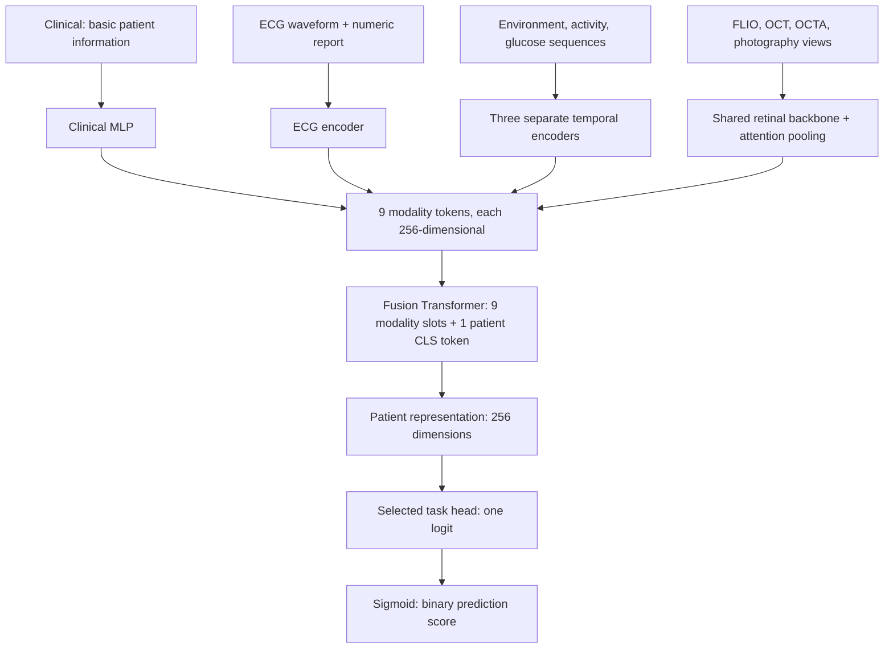

# OT2: a guide to the model and experiments

This repository contains the AI-READI multimodal classification model and its modality-removal experiments. It has **nine modality inputs**, each summarized into a **256-dimensional vector**, followed by a small Transformer that combines them to predict a binary outcome.

The latest completed experiment is **Basic Clinical retraining**: only 23 basic patient-information columns are supplied to the Clinical branch, alongside the other eight modalities. [Current_Summary.md](Current_Summary.md) contains those results. Earlier full-Clinical models and their inference-time ablations are separate experiments.

## Where should I look first?

| Question | File / starting point |
|---|---|
| Where are all the encoders assembled? | [Task2V2Model](task2_v2_model.py#L1172) |
| How are the modalities combined? | [PresenceAwareFusion](task2_v2_model.py#L1099) |
| Where is the classifier? | [BinaryTaskHead](task2_v2_model.py#L1158) |
| What architecture and training settings were used? | [MoCA configuration](configs/task2_v2_moca_full_assets_v1.yaml), [CVD broad](configs/task2_v2_cvd_broad_full_assets_v1.yaml), [CVD strict](configs/task2_v2_cvd_strict_full_assets_v1.yaml) |
| How do saved data become model inputs? | [task2_v2_dataset.py](task2_v2_dataset.py), [data_preprocessing/](data_preprocessing/) |
| How is the model trained? | [train_task2_v2.py](train_task2_v2.py), [task2_v2_engine.py](task2_v2_engine.py) |
| How is the current retraining experiment run? | [run_basic_retrain_v1.py](run_basic_retrain_v1.py) |
| Where is leave-one-out implemented? | [analyze_basic_retrained_v1.py](analyze_basic_retrained_v1.py), using [analyze_modality_importance_v2.py](analyze_modality_importance_v2.py) |

The settings below follow the three `full_assets_v1.yaml` configurations and the current Basic Clinical retraining path. The model class also supports a small CNN for testing; the reported experiment selects **ResNet-18** in its configuration.

## The whole model

A *token* here means a learned vector summarizing one input. A *mask* identifies which values or inputs are actually observed. A *CLS token* is a learned summary token whose final representation is used for prediction.

## What does each encoder do?

All branches produce one 256-dimensional vector per participant. The temporal and fusion Transformers use **2 layers, 4 attention heads, a feed-forward width of 512, GELU activation, and dropout 0.2**.

| Modality / code name | Input and encoder | Implementation |
|---|---|---|
| Clinical — `clinical_data` | Scaled feature values plus observation masks → MLP | [MaskAwareVectorEncoder](task2_v2_model.py#L298) |
| ECG — `cardiac_ecg` | Parallel 12-lead waveform → waveform-patch Transformer; 8 report values → MLP; combine the two outputs | [ECGEncoder](task2_v2_model.py#L555), [MaskedWaveformPatchEncoder](task2_v2_model.py#L471) |
| Environment — `environment` | Multichannel 5-minute sequence → patch summaries → Transformer | [MaskedTemporalPatchEncoder](task2_v2_model.py#L338) |
| Activity — `wearable_activity_monitor` | Activity sequence on a 5-minute grid → patch summaries → Transformer | [MaskedTemporalPatchEncoder](task2_v2_model.py#L338) |
| Glucose — `wearable_blood_glucose` | CGM sequence on a 5-minute grid → patch summaries → Transformer | [MaskedTemporalPatchEncoder](task2_v2_model.py#L338) |
| Four retinal modalities — `retinal_flio`, `retinal_oct`, `retinal_octa`, `retinal_photography` | Prepared 2-D views → shared ResNet-18 → attention pooling → **four separate modality vectors** | [HierarchicalRetinalEncoder](task2_v2_model.py#L951) |

### Clinical

For `F` features, the encoder concatenates `F` scaled values and `F` observation indicators, then applies:

`2F → Linear(512) → LayerNorm → GELU → Dropout → Linear(256) → LayerNorm`

In the current experiment, `F = 23`, so the first linear layer receives **46 inputs**. The retained columns represent age-related information (3), education (9), marital status (5), and language background (6). These are encoded columns, not 23 independent clinical measurements. The exact selection is in [clinical_basic_information_v1.py](clinical_basic_information_v1.py).

[prepare_basic_clinical_training_v1.py](prepare_basic_clinical_training_v1.py) physically projects the Clinical table and scaler to these 23 columns and creates `train_config.yaml`. Retained training-set scaler parameters are copied without refitting. In earlier full-Clinical experiments, `F` was larger and task-specific.

### ECG: leads and time are different axes

One record has shape **`T × 12`**: `T` time samples, with 12 simultaneously recorded lead channels at each sample.

The waveform encoder divides the time axis into non-overlapping **100-sample patches**. Each patch contains `100 × 12` values plus their validity masks. These are flattened to **2,400 inputs** and projected to 256 dimensions. This preserves within-patch sample order before compression. Sinusoidal positional encoding and a CLS token are added before temporal attention.

For example, a 5,500-sample record at 500 Hz spans 11 seconds and gives 55 waveform patches, plus one CLS token. The implementation permits other record lengths; preprocessing preserves native sampling frequency and duration by default unless explicitly configured otherwise.

The eight numeric report fields are **Rate, PR, QRSD, QT, QTc, P, QRS, T**. Their values and masks pass through a separate MLP. The two 256-dimensional outputs and two availability flags are concatenated into 514 inputs, then mapped `514 → 256 → 256` to form the ECG token. Removing ECG removes both waveform and report information. See [ECG preprocessing](data_preprocessing/build_ecg_waveform_features_v2.py).

### Environment and wearable sequences

Each encoder groups **12 consecutive 5-minute slots** into a one-hour patch. For each channel it computes the mean of observed values and the fraction of observed slots, projects these summaries to 256 dimensions, adds sinusoidal positions and a CLS token, and applies the temporal Transformer.

These patches summarize values within the hour; the ECG patch encoder instead exposes individual samples to its projection. Environment, activity and CGM have the same encoder design but **separate weights**. Their channel counts come from the fitted schemas/scalers.

### Retinal images

An *asset* is an indexed acquisition/product; a *view* is a prepared 2-D image from that asset. The model input has shape `batch × assets × views × 3 × 224 × 224`.

All four retinal modalities share an **ImageNet-1K pretrained ResNet-18**, whose classification layer is removed. Its weights and batch-normalization statistics remain frozen. Each view produces 512 features, projected to 256 dimensions. Learned attention pooling combines **views into assets**, then **assets into a modality vector**. The view projection and view pooling are shared; asset pooling and the final projection are specific to each retinal modality. These projection/pooling layers are trainable.

The model consumes the saved `model_views`: photographs, selected central OCT/OCTA slices or OCTA en-face products, and FLIO-derived intensity/mean-bin views. The FLIO mean-bin feature is a photon-weighted frame index, **not a fitted physical fluorescence lifetime**. The full FLIO decay cube is not passed to this CNN. See [retinal preprocessing](data_preprocessing/preprocess_retinal_assets_v2.py) and [compact model-view files](build_retinal_model_view_sidecars_v2.py).

## Fusion and prediction

[PresenceAwareFusion](task2_v2_model.py#L1099) receives `batch × 9 × 256` modality tokens and nine presence indicators. It replaces an unavailable modality with that modality's learned missing vector, adds learned modality-identity embeddings, and prepends a patient CLS token. The **10-token sequence** passes through the fusion Transformer. The normalized patient CLS output is the 256-dimensional patient representation.

Missing slots remain in the fusion sequence. Their learned vectors indicate absence; they do not reconstruct the participant's missing measurement.

The selected [BinaryTaskHead](task2_v2_model.py#L1158) applies `256 → Linear(256) → GELU → Dropout → Linear(1)`. Evaluation applies a sigmoid to the logit. Although the class contains three task heads, the reported workflow **trains a separate model per task**, using that task's labels and head; it does not jointly optimize all three outcomes.

## Training and modality importance

The current experiment uses seed 42, AdamW, learning rate `5e-5`, weight decay `0.01`, batch size 2, gradient accumulation over 16 batches, and BF16. The schedule uses 10% linear warmup followed by cosine decay. Binary cross-entropy uses a positive-class weight estimated from training labels. Training lasts at most 30 epochs, with early stopping after 7 epochs without validation AUROC improvement. The best checkpoint and the Youden classification threshold are selected using validation data. The current report contains no test evaluation.

Leave-one-out freezes that checkpoint, disables one modality, and measures the change on the same participants. It also removes all retinal inputs, both wearable inputs, or all eight nonclinical inputs together. Source tokens are cached to avoid repeatedly encoding images and sequences; the cached baseline is checked against the full forward pass. Fusion and the task head are recomputed after changing availability.

Positive AUROC degradation means `AUROC_before − AUROC_after > 0`. The report includes 2,000 paired, outcome-stratified bootstrap resamples and availability subgroups. These are model-reliance estimates; the intervals do not include training-seed uncertainty or multiplicity correction. Ablation does not train a new reduced-input model or establish reconstruction performance.

## Which files belong to which experiment?

| Experiment | Main files / result |
|---|---|
| Original full-Clinical supervised models | [train_task2_v2.py](train_task2_v2.py), the three `full_assets_v1.yaml` configurations |
| Frozen-model Clinical/domain removals | [analyze_domain_ablation_v1.py](analyze_domain_ablation_v1.py), [analyze_clinical_abcd_v1.py](analyze_clinical_abcd_v1.py); `SUMMARY_val*.md` / `SUMMARY_test*.md` |
| **Current: Basic Clinical retraining + ablation** | [prepare_basic_clinical_training_v1.py](prepare_basic_clinical_training_v1.py) → [train_basic_clinical_v1.py](train_basic_clinical_v1.py) → [analyze_basic_retrained_v1.py](analyze_basic_retrained_v1.py); [Current_Summary.md](Current_Summary.md) |
| Separate universal reconstruction implementation | [task2_v2_universal_reconstruction.py](task2_v2_universal_reconstruction.py), [train_universal_reconstruction_v2.py](train_universal_reconstruction_v2.py), [evaluate_universal_reconstruction_v2.py](evaluate_universal_reconstruction_v2.py) |

The universal reconstruction code predicts missing **latent modality tokens** from observed tokens. It is a separate experimental path and was not used to obtain `Current_Summary.md`. Its presence in the repository does not demonstrate completed reconstruction experiments.

This repository is a code/results snapshot for collaborators. Running it requires the cluster data, fitted scalers, schemas and checkpoints referenced by the configurations. Release verification scripts additionally expect their distribution manifests, which are not included at this repository root.

## Short Methods draft for the current experiment

We trained separate binary classifiers for MoCA impairment, broad CVD and strict CVD using nine AI-READI modalities. The Clinical input was restricted to 23 encoded basic-information features. Modality-specific encoders produced 256-dimensional representations: a mask-aware multilayer perceptron for Clinical features, a waveform-patch Transformer combined with a numeric-report encoder for ECG, separate temporal Transformers for environment and wearable sequences, and a shared frozen ImageNet-pretrained ResNet-18 with hierarchical attention pooling for retinal views. A two-layer, four-head Transformer fused the nine modality representations with a patient summary token, using learned vectors for missing modalities. A task-specific multilayer perceptron generated the classification logit. Models were optimized with class-weighted binary cross-entropy, and checkpoint and threshold selection used validation data. We assessed modality reliance by freezing each selected model and comparing predictions before and after modality removal on paired validation participants.
