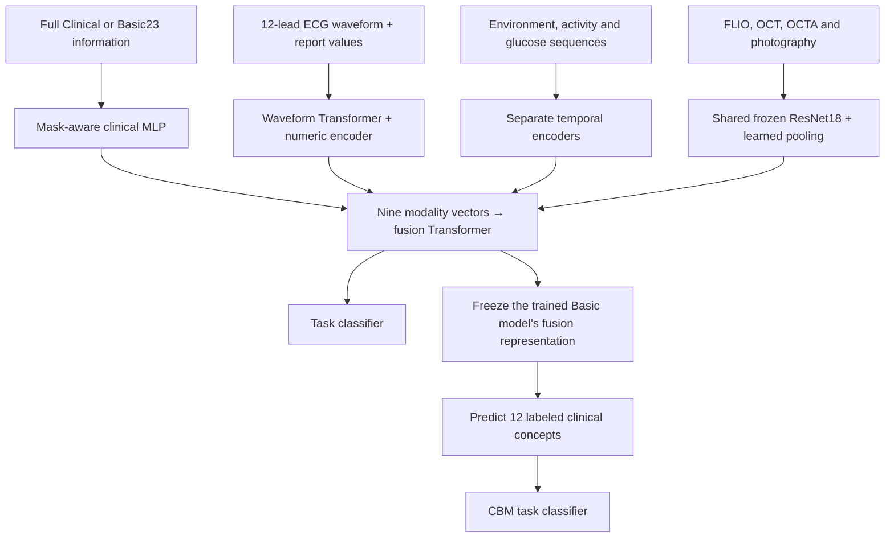

# OT2: multimodal prediction and clinical concept analysis

OT2 studies two linked questions using AI-READI data: which modalities a fitted classifier relies on, and which clinical concept channels carry changes in its predictions when an input is removed.

This repository contains the consolidated **six-task pipeline**: preprocessing, labels, train-only scaling, Full/Basic Clinical model training, original12 Concept Bottleneck Models (CBMs), modality ablation, concept-channel restoration, and validation/test reports. It replaces the earlier scripts on `main`; historical implementations and summaries remain available in Git history.

## Model overview



Each modality produces a 256-dimensional vector. The fusion Transformer combines the nine modality slots with a patient summary token. Each task has independently fitted Full Clinical and Basic Clinical models. **Basic23** means 23 encoded columns covering age-related information, education, marital status and language; the other eight modalities remain available.

The CBM is a separate readout of the trained Basic model's frozen fusion representation. Its concept predictor and classification head are jointly trained after sequential warmup (`lambda=1`, with a concept-alignment selection constraint). There is no latent or Basic Clinical bypass around the concept layer. The multimodal encoders/fusion are not jointly updated during this CBM stage.

The optional [Full Clinical CBM experiment](#full-clinical-cbm-and-clinical-information-removal) applies the same original12 readout to the frozen Full Clinical model and evaluates concept-channel restoration after removing nonbasic clinical information.

## Where to find each component

| Component | Implementation |
|---|---|
| Clinical encoder | [`MaskAwareVectorEncoder`](vendor/task2_v2_model.py#L298) |
| Environment, activity and glucose encoders | [`MaskedTemporalPatchEncoder`](vendor/task2_v2_model.py#L338) |
| ECG waveform and numeric encoder | [`MaskedWaveformPatchEncoder`](vendor/task2_v2_model.py#L471), [`ECGEncoder`](vendor/task2_v2_model.py#L555) |
| Four retinal modality representations | [`HierarchicalRetinalEncoder`](vendor/task2_v2_model.py#L951); frozen CNN caching in [`data.py`](data.py), learned pooling in [`train.py`](train.py) |
| Multimodal fusion and model assembly | [`PresenceAwareFusion`](vendor/task2_v2_model.py#L1099), [`Task2V2Model`](vendor/task2_v2_model.py#L1172) |
| Full/Basic fitting and modality ablation | [`train.py`](train.py), [`common.py`](common.py) |
| Concept prediction, joint CBM and restoration | [`concepts.py`](concepts.py), [`vendor/cbm_joint_v2.py`](vendor/cbm_joint_v2.py) |
| Concept IDs, measurements and groups | [Concept reference](report_update/CONCEPT_REFERENCE.md), [original12 specification](data_preprocessing_cluster/configs/cbm_concepts_v1.json) |
| Raw preprocessing and label preparation | [`data_preprocessing_cluster/`](data_preprocessing_cluster/), [`prepare_study_inputs.py`](prepare_study_inputs.py) |
| GPU scheduling and reports | [`run.py`](run.py), [`worker.py`](worker.py), [`report.py`](report.py) |

## Tasks and outputs

The six binary tasks are **MoCA < 26, CVD broad, CVD strict, osteoporosis history, kidney-problem history, and lung-problem history**. Their definitions are in the [original task config](data_preprocessing_cluster/configs/downstream_tasks.json) and [history task config](data_preprocessing_cluster/configs/history_tasks_v1.json). The latter retains seven audited candidate outcomes; only the three history outcomes above are trained here.

Four tables are generated separately for validation and test, reporting **AUROC, balanced accuracy and positive-class F1**, with paired bootstrap intervals for effects:

| Table | Comparison |
|---|---|
| 1 | Full Clinical model; that model with only Basic Clinical retained at inference; retrained Basic Clinical model |
| 2 | Basic model ablation: each of nine modalities, all retinal, all wearable, and all eight nonclinical inputs |
| 3 | Basic multimodal classifier versus its original12 CBM readout |
| 4 | Predicted concept-group restoration after source removal; top three groups selected on validation and held fixed on test |

Table 4 restores a participant's concept channels predicted with complete inputs. It identifies model pathways; it does **not** implement a deployable missing-modality reconstruction algorithm or establish causal clinical effects. Thresholds and checkpoints are selected on validation. Earlier test results have already been examined in this project, so the test set should not be described as a previously untouched confirmatory cohort.

## Run on the Cluster

Reuse the existing `ot2` conda environment and processed inputs. Check input paths in [`study.yaml`](study.yaml) and [`configs/`](configs/). In a job allocated four H100 GPUs:

```bash
git clone https://github.com/WingsYou/OT2.git
cd OT2
conda activate ot2
python -u pipeline.py train --devices 0 1 2 3 \
  --output-root /data/pzhao3/ot2_output/six_task_complete_v1_20260913
```

This command fits fresh models from existing processed data. It does not rerun raw preprocessing. Four GPUs run independent jobs, sharing cached frozen retinal features; ablation reuses source tokens and bootstrap calculations are batched on GPU. Use a new output directory when changing code or experimental settings.

To regenerate reports for an already completed run without training:

```bash
python -u pipeline.py report \
  --study-config /path/to/completed_run/runtime.yaml
```

Reports are written to `<output_root>/tables/SUMMARY_val.md` and `SUMMARY_test.md`, with CSV tables, concept definitions and F1 operating-point details. No patient data, participant predictions, checkpoints or pretrained weights are included in this repository.

## Full Clinical CBM and clinical-information removal

For an **already completed six-task run**, pull this repository and launch:

```bash
git pull --ff-only
conda activate ot2
python -u run_full_clinical_cbm.py \
  --source-root /data/pzhao3/ot2_output/six_task_complete_v1_20260913 \
  --devices 0 1 2 3
```

Set `--source-root` to your actual completed result directory, the one containing `runtime.yaml`, `inputs.json`, `cache/`, and the six task folders. If you used the default in `study.yaml`, it is `/data/pzhao3/ot2_output/six_task_study_v1_20260913`. The launcher reads that run's settings and concept-label paths automatically. It does not rerun preprocessing or train the Full/Basic multimodal models.

Each GPU processes one task at a time. Existing validation/test source tokens are reused; only clinical encoding and fusion are recomputed for the masked condition. Full-model training embeddings are exported once when absent. Concept training uses the existing GPU implementation, and confidence intervals use the same GPU-batched bootstrap. Completed tasks and saved CBM checkpoints are reused when the same command is rerun. The new launcher does not compute or compare code/file SHA hashes.

The experiment keeps Basic23 and all eight nonclinical modalities, masks every other clinical value **and its observation indicator**, and evaluates the frozen Full Clinical CBM without refitting or threshold retuning. Seven concept groups are restored individually using the same participant's **full-input predicted concepts**. The six cardiometabolic concepts and all twelve concepts are also restored together. All-twelve restoration reproduces the full-input CBM prediction; this provides a complete-restoration reference. Validation selects the top three individual groups, and that ranking is fixed on test. The original12 definitions and concept-alignment selection constraint are unchanged.

Outputs go to `<source-root>/full_clinical_cbm/`, separately from the earlier results:

- `tables/SUMMARY_FULL_CBM_val.md` and `SUMMARY_FULL_CBM_test.md`: classification, removal degradation, group recovery, and concept definitions.
- `tables/classification_*.csv`, `degradation_*.csv`, `restoration_*.csv`, and `top3_*.csv`: AUROC, balanced accuracy and positive-class F1, paired intervals, full/masked/restored metrics, and remaining gaps.
- `<task>/`: CBM checkpoints, training logs, participant predictions, full/masked concept predictions and selected settings; `logs/`: per-task console logs.

The comparison includes the existing Basic Clinical and Basic Clinical + CBM results when present. Sequential Full Clinical CBM results are retained in the detailed classification CSVs; the main report uses joint lambda=1 with the original sequential fallback. All comparisons use the entire labeled split and report how many participants actually had observed nonbasic clinical features.

Optional arguments are `--tasks moca_binary cvd_broad_binary`, `--output-root /path/to/new/results`, `--bootstrap-samples 2000`, and `--report-only`. Use another output directory for a changed experiment; resume an interrupted run with the original command. No additional packages are required beyond the existing environment.

Full Clinical inputs contain information used to define the concept labels. This extension evaluates how that information passes through a concept bottleneck and what happens when it is removed. It does not establish recovery from independent nonclinical inputs: restored channels use the unavailable full-input prediction as a diagnostic reference, as in the previous restoration experiment.

## Train on full + masked inputs; deploy with masked inputs

This minimal follow-up trains **one shared CBM** on both input conditions, with equal weight for each participant's full and masked views. It keeps the original Full Clinical encoders **and fusion frozen**, and updates only the original12 concept predictor and its classifier. Unlike the restoration experiment, evaluation predicts every concept from the masked input itself.

```bash
git pull --ff-only
conda activate ot2
python -u run_full_clinical_cbm.py \
  --source-root /data/pzhao3/ot2_output/six_task_complete_v1_20260913 \
  --mixed-training --devices 0 1 2 3
```

Use the same `--source-root` as in your previous experiment. Existing Full Clinical CBM caches are reused from `<source-root>/full_clinical_cbm`; if those results are elsewhere, supply `--full-cbm-root /path/to/previous/full_cbm_results`. Only masked **training** embeddings need to be added when the previous caches are complete. Both input views retain Basic23 and the eight nonclinical modalities; the masked view additionally zeros all other clinical values and their observation indicators.

The two training views share the same task label and observed concept targets. Their losses are averaged equally in concept warmup, classifier warmup and joint training (`lambda=1`). Missing concept targets remain masked. Embedding scaling is fitted to full training embeddings, and concept scaling to observed training labels, as before. Checkpoint selection, the existing 10% concept-alignment constraint, and Youden-threshold selection now use **masked validation**. Test evaluation uses only masked inputs and the fixed validation thresholds. There is no teacher prediction substitution, measured-concept injection, or full-input reference at inference.

The run fits fresh CBM readouts on the existing backbone, schedules one task per GPU, and uses the same batched bootstrap. It writes separate results to `<source-root>/mixed_clinical_cbm/`:

- `tables/SUMMARY_MIXED_CBM_val.md` and `SUMMARY_MIXED_CBM_test.md`: masked-only performance and paired improvements, plus concept prediction accuracy wherever measured labels are available.
- `tables/classification_*.csv`, `gains_*.csv`, `concept_metrics_*.csv`: AUROC, balanced accuracy, F1, paired intervals, and per-concept errors.
- `<task>/models.pt`, `training.csv`, `selection.json`, `predictions_*.csv`, `masked_concepts_*.npz`; and per-task logs under `logs/`.

Comparators are the original Full Clinical classifier and, when available, the previous Full-only-trained CBM, both evaluated with masked inputs. Their thresholds are reselected using masked validation, so balanced accuracy/F1 can differ from the earlier report that kept full-input thresholds. The original comparator checkpoints are reused unchanged. The mixed sequential checkpoint is also retained in the detailed CSVs; the main table uses joint lambda=1 with sequential fallback.

Rerun the same command to reuse completed tasks. Add `--report-only` to regenerate summaries, or `--tasks moca_binary cvd_broad_binary` to run a subset. Use a separate `--output-root` when changing experiment settings. This experiment tests mixed-input training of a frozen-representation CBM; it does not yet fine-tune fusion or compare against a non-CBM classifier trained with the same masking.

## Concept restoration after mixed training

After the mixed-training run completes, evaluate concept restoration with its saved checkpoint:

```bash
git pull --ff-only
conda activate ot2
python -u run_full_clinical_cbm.py \
  --source-root /data/pzhao3/ot2_output/six_task_complete_v1_20260913 \
  --mixed-restoration --devices 0 1 2 3
```

Use your previous six-task `--source-root`. This mode reads `<source-root>/mixed_clinical_cbm/runtime.yaml`, reuses its saved settings and masked-feature cache paths, and **does not train any model or rerun preprocessing/encoders/fusion**. If your mixed-training output is elsewhere, supply `--mixed-cbm-root /path/to/completed/mixed_results`. `--mixed-restoration` replaces `--mixed-training`; they are separate modes.

For each task, the selected mixed-training CBM predicts concepts from the cached full and masked embeddings. Starting from the masked prediction, each of the seven concept groups is replaced separately with the same participant's **full-input prediction from that same mixed-training model**. The six cardiometabolic concepts and all twelve concepts are restored together in two additional conditions. The saved **masked-validation threshold** stays fixed across full, masked and restored predictions. Validation ranks the seven individual groups; test retains that ranking. All six tasks are evaluated on both splits using the whole labeled cohort. No measured concept labels are needed, including for test.

Results are written separately to `<source-root>/mixed_clinical_cbm_restoration/`:

- `tables/SUMMARY_MIXED_RESTORATION_val.md` and `SUMMARY_MIXED_RESTORATION_test.md`: same-model full/masked performance and initial gaps, followed by absolute restored AUROC/balanced accuracy/F1 and paired recovery intervals for every group.
- `tables/classification_*.csv`, `degradation_*.csv`, `restoration_*.csv`, `top3_*.csv`: detailed effects, validation ranks and remaining gaps.
- Per-task predictions, full/masked bottleneck values, selected settings and console logs.

The selected sequential fallback is reused when joint training did not yield an accepted update. This diagnostic uses an unavailable full-input reference at deployment; it is not measured-concept correction or autonomous reconstruction. All-twelve restoration equals the full-input decision by construction. After successful masked training, a smaller remaining gap or negative recovery is possible and should be reported rather than treated as a failed run. Resume with the same command; use `--report-only` to regenerate reports.

For preparation from raw data, fill in the actual manifest paths in [`pipeline.yaml`](pipeline.yaml) and follow [PREPARATION.md](PREPARATION.md). The [detailed Cluster guide](CLUSTER_GUIDE.md) describes the experiment definitions, defaults and recovery behavior. Dependencies are listed in [requirements.txt](requirements.txt) and [requirements-all.txt](requirements-all.txt); preserve the working CUDA PyTorch/torchvision installation.

Local integration checks used synthetic data. The consolidated raw-to-report workflow has not been executed on the real Cluster dataset as a single run; existing processed outputs remain the default input for current experiments.
