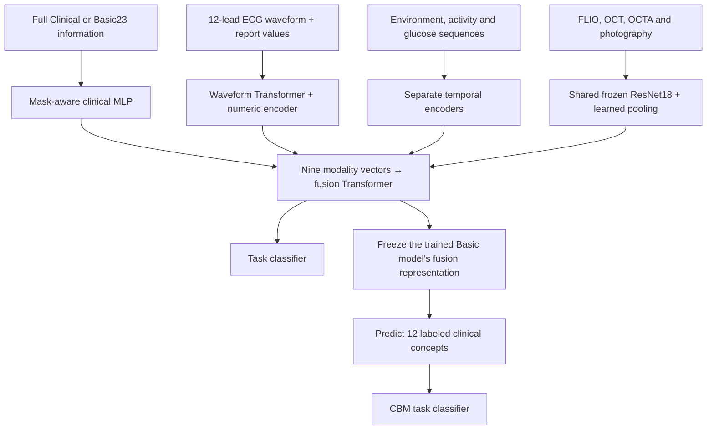

# OT2: multimodal prediction and clinical concept analysis

OT2 studies two linked questions using AI-READI data: which modalities a fitted classifier relies on, and which clinical concept channels carry changes in its predictions when an input is removed.

This repository contains the consolidated **six-task pipeline**: preprocessing, labels, train-only scaling, Full/Basic Clinical model training, original12 Concept Bottleneck Models (CBMs), modality ablation, concept-channel restoration, and validation/test reports. It replaces the earlier scripts on `main`; historical implementations and summaries remain available in Git history.

## Model overview



Each modality produces a 256-dimensional vector. The fusion Transformer combines the nine modality slots with a patient summary token. Each task has independently fitted Full Clinical and Basic Clinical models. **Basic23** means 23 encoded columns covering age-related information, education, marital status and language; the other eight modalities remain available.

The CBM is a separate readout of the trained Basic model's frozen fusion representation. Its concept predictor and classification head are jointly trained after sequential warmup (`lambda=1`, with a concept-alignment selection constraint). There is no latent or Basic Clinical bypass around the concept layer. The multimodal encoders/fusion are not jointly updated during this CBM stage.

## Where to find each component

| Component | Implementation |
|---|---|
| Clinical encoder | [`MaskAwareVectorEncoder`](vendor/task2_v2_model.py#L298) |
| Environment, activity and glucose encoders | [`MaskedTemporalPatchEncoder`](vendor/task2_v2_model.py#L338) |
| ECG waveform and numeric encoder | [`MaskedWaveformPatchEncoder`](vendor/task2_v2_model.py#L471), [`ECGEncoder`](vendor/task2_v2_model.py#L555) |
| Four retinal modality representations | [`HierarchicalRetinalEncoder`](vendor/task2_v2_model.py#L951); frozen CNN caching in [`data.py`](data.py), learned pooling in [`train.py`](train.py) |
| Multimodal fusion and model assembly | [`PresenceAwareFusion`](vendor/task2_v2_model.py#L1099), [`Task2V2Model`](vendor/task2_v2_model.py#L1172) |
| Full/Basic fitting and modality ablation | [`train.py`](train.py), [`common.py`](common.py) |
| Concept prediction, joint CBM and restoration | [`concepts.py`](concepts.py), [`vendor/cbm_joint_v2.py`](vendor/cbm_joint_v2.py) |
| Concept IDs, measurements and groups | [Concept reference](report_update/CONCEPT_REFERENCE.md), [original12 specification](data_preprocessing_cluster/configs/cbm_concepts_v1.json) |
| Raw preprocessing and label preparation | [`data_preprocessing_cluster/`](data_preprocessing_cluster/), [`prepare_study_inputs.py`](prepare_study_inputs.py) |
| GPU scheduling and reports | [`run.py`](run.py), [`worker.py`](worker.py), [`report.py`](report.py) |

## Tasks and outputs

The six binary tasks are **MoCA < 26, CVD broad, CVD strict, osteoporosis history, kidney-problem history, and lung-problem history**. Their definitions are in the [original task config](data_preprocessing_cluster/configs/downstream_tasks.json) and [history task config](data_preprocessing_cluster/configs/history_tasks_v1.json). The latter retains seven audited candidate outcomes; only the three history outcomes above are trained here.

Four tables are generated separately for validation and test, reporting **AUROC, balanced accuracy and positive-class F1**, with paired bootstrap intervals for effects:

| Table | Comparison |
|---|---|
| 1 | Full Clinical model; that model with only Basic Clinical retained at inference; retrained Basic Clinical model |
| 2 | Basic model ablation: each of nine modalities, all retinal, all wearable, and all eight nonclinical inputs |
| 3 | Basic multimodal classifier versus its original12 CBM readout |
| 4 | Predicted concept-group restoration after source removal; top three groups selected on validation and held fixed on test |

Table 4 restores a participant's concept channels predicted with complete inputs. It identifies model pathways; it does **not** implement a deployable missing-modality reconstruction algorithm or establish causal clinical effects. Thresholds and checkpoints are selected on validation. Earlier test results have already been examined in this project, so the test set should not be described as a previously untouched confirmatory cohort.

## Run on the Cluster

Reuse the existing `ot2` conda environment and processed inputs. Check input paths in [`study.yaml`](study.yaml) and [`configs/`](configs/). In a job allocated four H100 GPUs:

```bash
git clone https://github.com/WingsYou/OT2.git
cd OT2
conda activate ot2
python -u pipeline.py train --devices 0 1 2 3 \
  --output-root /data/pzhao3/ot2_output/six_task_complete_v1_20260913
```

This command fits fresh models from existing processed data. It does not rerun raw preprocessing. Four GPUs run independent jobs, sharing cached frozen retinal features; ablation reuses source tokens and bootstrap calculations are batched on GPU. Use a new output directory when changing code or experimental settings.

To regenerate reports for an already completed run without training:

```bash
python -u pipeline.py report \
  --study-config /path/to/completed_run/runtime.yaml
```

Reports are written to `<output_root>/tables/SUMMARY_val.md` and `SUMMARY_test.md`, with CSV tables, concept definitions and F1 operating-point details. No patient data, participant predictions, checkpoints or pretrained weights are included in this repository.

For preparation from raw data, fill in the actual manifest paths in [`pipeline.yaml`](pipeline.yaml) and follow [PREPARATION.md](PREPARATION.md). The [detailed Cluster guide](CLUSTER_GUIDE.md) describes the experiment definitions, defaults and recovery behavior. Dependencies are listed in [requirements.txt](requirements.txt) and [requirements-all.txt](requirements-all.txt); preserve the working CUDA PyTorch/torchvision installation.

Local integration checks used synthetic data. The consolidated raw-to-report workflow has not been executed on the real Cluster dataset as a single run; existing processed outputs remain the default input for current experiments.
